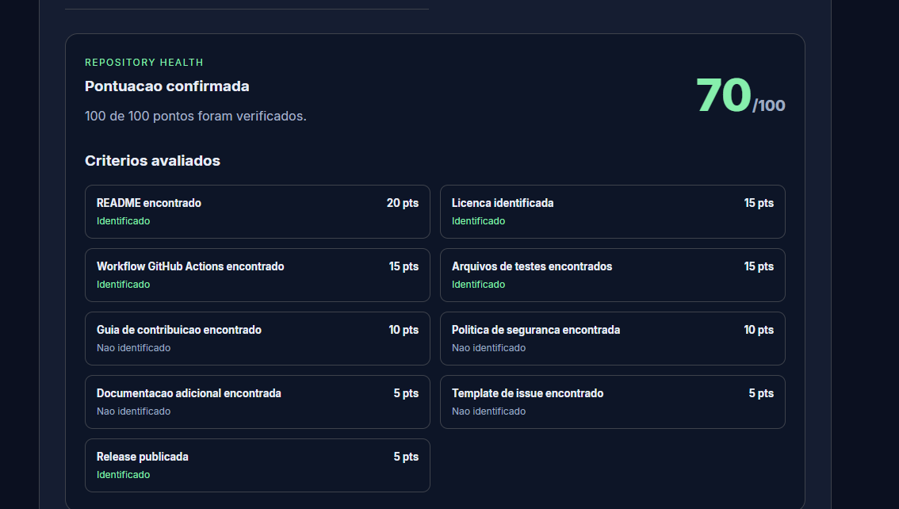

# RepoDoctor

**Know your repository. Improve your open source projects.**

A free, open-source GitHub repository health analyzer that helps
developers identify good practices and opportunities for improvement.

[**Try it online**](https://pedrocostinha.github.io/RepoDoctor/) |
[Latest Release](https://github.com/PedroCostinha/RepoDoctor/releases/latest) |
[Source Code](https://github.com/PedroCostinha/RepoDoctor)

---

## What is RepoDoctor?

RepoDoctor analyzes public GitHub repositories and provides a
health score based on observable repository practices.

No account, installation, or API token is required to try the
hosted version.

## Features

- **Health score:** evaluate repositories on a 0-100 scale.
- **Nine criteria:** inspect documentation and development practices.
- **Repository overview:** view stars, forks, issues and metadata.
- **Evidence-based results:** distinguish present, absent and unknown.
- **Responsive interface:** use RepoDoctor on desktop or mobile.
- **Public GitHub API:** inspect repositories without authentication.

## Preview

## How the score works

[Detailed scoring documentation](docs/scoring.md)

| Criterion | Maximum points |
| --- | ---: |
| README | 20 |
| License | 15 |
| GitHub Actions workflow | 15 |
| Test files | 15 |
| Contributing guide | 10 |
| Security policy | 10 |
| Additional documentation | 5 |
| Issue templates | 5 |
| Published release | 5 |
| **Total** | **100** |

When some information cannot be verified, RepoDoctor displays
a partial result rather than assuming that the practice is absent.

**Important:** The score measures detectable repository practices.
It does not certify code quality or security.

## Try RepoDoctor

**Live application:**

https://pedrocostinha.github.io/RepoDoctor/

Enter a public GitHub repository, for example:

    PedroCostinha/RepoDoctor

Click **Analisar** to view the repository report.

## Run locally

Requirements: Node.js 22.12+ and npm.

Clone the repository:

    git clone https://github.com/PedroCostinha/RepoDoctor.git
    cd RepoDoctor

Install dependencies and start the development server:

    npm ci
    npm run dev

Open the local address displayed by Vite.

## Quality checks

    npm run test
    npm run build
    npm run lint

The initial release includes seven automated tests.

## Technology stack

- React
- TypeScript
- Vite
- Vitest
- Oxlint
- GitHub REST API
- GitHub Actions
- GitHub Pages

## Current limitations

- Public GitHub repositories only.
- Unauthenticated API requests are rate-limited by GitHub.
- File detection is heuristic and does not execute repository code.
- Incomplete API responses may produce partially verified scores.
- The score is not a vulnerability or security audit.

## Roadmap

- [x] Repository overview
- [x] GitHub REST API integration
- [x] Repository health scoring
- [x] Automated tests
- [x] GitHub Pages deployment
- [x] First public release
- [ ] Screenshots and demonstration
- [ ] Portuguese and English language options
- [ ] Shareable reports
- [ ] More detailed repository recommendations

## Contributing

Suggestions, bug reports and improvements are welcome.

You can start by opening an issue to discuss your idea.

## License

Distributed under the [MIT License](LICENSE).

## Author

Created and maintained by
[PedroCostinha](https://github.com/PedroCostinha).

---

**Built for developers who care about better repositories.**

[Open RepoDoctor](https://pedrocostinha.github.io/RepoDoctor/)

